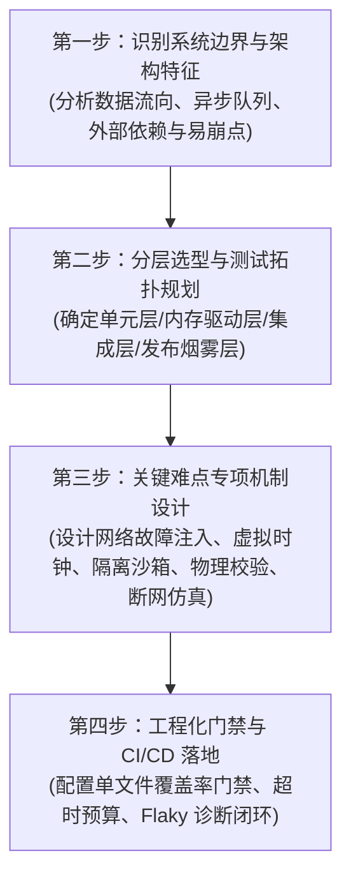

# 业界顶级开源项目自动化测试方案与测试用例设计知识库

> 专为构建工业级、高可靠、复杂软件系统自动化测试体系而设立的架构方案与实战用例设计知识库。深入解构 21 个业界顶级开源项目（涵盖 AI Agent、Web 自动化、云原生容器、分布式存储、富客户端 IDE、分布式工作流、API 网关、监控流管道、复杂 Web 交互与协同画布等）的自动化测试蓝图。

---

## 目录导航

- [1. 21 大开源项目自动化测试方案全景矩阵](#1-21-大开源项目自动化测试方案全景矩阵)
  - [Part A: 系统级中间件、基础设施与 AI Agent 架构 (01 ~ 11)](#part-a-系统级中间件基础设施与-ai-agent-架构-01--11)
  - [Part B: 复杂 Web 交互与高性能数据处理平台 (12 ~ 21)](#part-b-复杂-web-交互与高性能数据处理平台-12--21)
- [2. 核心系统测试模式与设计思想沉淀](#2-核心系统测试模式与设计思想沉淀)
- [3. 21 大开源项目深度剖析文档索引](#3-21-大开源项目深度剖析文档索引)
- [4. 如何为复杂系统设计自动化测试方案](#4-如何为复杂系统设计自动化测试方案)
- [5. 可复用企业级设计模板](#5-可复用企业级设计模板)

---

## 1. 21 大开源项目自动化测试方案全景矩阵

### Part A: 系统级中间件、基础设施与 AI Agent 架构 (01 ~ 11)

| 序号 | 开源项目 | 领域 / 架构类型 | 测试框架 / 基础设施 | 核心测试模式与特色技术 | 方案文档 |
| :---: | :--- | :--- | :--- | :--- | :---: |
| **01** | **DeepSeek Harness** | 自主 AI Agent / 微内核插件体系 | Vitest, Playwright, 自研 Mock Server | **100% 单文件覆盖率门禁**、24种可编排网络故障注入、会话快照与时空包络投影、验证真实物理世界而非自述日志 | [查看方案](schemes/01_deepseek-harness_ai_agent_testing_scheme.md) |
| **02** | **Microsoft Playwright** | 跨浏览器端到端 Web 自动化引擎 | Playwright Test Runner, CDP/Bidi | **自动等待（Auto-waiting）无休眠断言**、毫秒级 BrowserContext 状态沙箱隔离、网络底层路由拦截与 Trace 录制 | [查看方案](schemes/02_playwright_browser_e2e_testing_scheme.md) |
| **03** | **FastAPI** | 现代异步高性能 API 框架 | Pytest, Starlette TestClient, Pydantic | **纯内存 ASGI 请求驱动（零网络端口开销）**、无侵入依赖注入替换（Dependency Overrides）、OpenAPI 3.1 契约架构快照 | [查看方案](schemes/03_fastapi_restful_contract_testing_scheme.md) |
| **04** | **Moby (Docker)** | 云原生容器编排与系统守护进程 | Go `testing`, `gotest.tools/icmd`, DinD | **瞬时独立守护进程（Ephemeral Daemon）**、CLI 退出码与 stdout/stderr 精准分流断言、Linux Cgroups/内核属性穿透校验 | [查看方案](schemes/04_moby_docker_daemon_cli_testing_scheme.md) |
| **05** | **Redis** | 高性能分布式内存键值数据库 | Tcl 测试框架, AddressSanitizer, Valgrind | **动态多节点拓扑编排**、哨兵故障转移与脑裂模拟、增量同步积压缓冲区边界测试、C 语言内存安全常态化门禁 | [查看方案](schemes/05_redis_distributed_storage_testing_scheme.md) |
| **06** | **Microsoft VS Code** | 大型桌面富客户端 IDE 与插件生态 | Electron Driver, Playwright, Mocha | **打包制品真实原生 Smoke 烟雾测试**、独立 Extension Host 插件隔离宿主测试、内存虚拟文件系统（InMemoryFS） | [查看方案](schemes/06_vscode_desktop_extension_testing_scheme.md) |
| **07** | **Vitest** | 现代 ESM 测试运行器与编译工具 | Vitest 自身 (自举), Tinypool, Vite HMR | **Worker 线程池环境隔离与全局防污染断言**、内联快照 AST 源码安全回写、Watch 模式增量依赖反向追踪重跑 | [查看方案](schemes/07_vitest_test_runner_isolation_testing_scheme.md) |
| **08** | **Temporal** | 分布式工作流与高可靠状态机 | Temporal TestServer, Time-Skipping SDK | **虚拟时钟时间跃迁（Time-Skipping）**、历史生产事件确定性重放验证（Replay Test）、Activity 重试风暴与 Worker 强杀自愈 | [查看方案](schemes/08_temporal_distributed_workflow_testing_scheme.md) |
| **09** | **Apache APISIX** | 云原生高性能微服务 API 网关 | `Test::Nginx`, OpenResty, etcd 集群 | **声明式 HTTP 报文测试规范**、动态路由热加载零停机时延断言、插件生命周期 6 阶段管道拦截与双向熔断恢复 | [查看方案](schemes/09_apisix_cloud_native_gateway_testing_scheme.md) |
| **10** | **Sentry** | 高吞吐事件流监控与异步管道 | Pytest, In-memory TaskRunner, Snuba Mock | **异步流消息管道同步化受控测试**、错误指纹（Fingerprinting）与 Issue 智能聚合算法双向不变性断言、告警风暴抑制验证 | [查看方案](schemes/10_sentry_event_pipeline_monitoring_testing_scheme.md) |
| **11** | **LangChain** | 大模型应用与 RAG 智能体工具链 | Pytest, VCR.py, FakeListLLM | **基于 VCR 磁带的高保真网络录制与零成本离线回放**、非确定性自然语言输出容错反解析、Agent 死循环步数硬性熔断保护 | [查看方案](schemes/11_langchain_rag_agent_testing_scheme.md) |

---

### Part B: 复杂 Web 交互与高性能数据处理平台 (12 ~ 21)

| 序号 | 开源项目 | 领域 / 架构类型 | 测试框架 / 基础设施 | 核心测试模式与特色技术 | 方案文档 |
| :---: | :--- | :--- | :--- | :--- | :---: |
| **12** | **Discourse** | 现代大型社区论坛与协作平台 | RSpec, QUnit, Playwright, MessageBus | **富文本输入光标与异步上传占位符替换测试**、长轮询/WebSocket 订阅鉴权拦截、用户信任等级（TL）计算引擎幂等性断言 | [查看方案](schemes/12_discourse_community_web_testing_scheme.md) |
| **13** | **Grafana** | 交互式数据监控大盘与可视化引擎 | Playwright, React Testing Library, Go Test | **网格拖拽布局碰撞检测与坐标持久化校验**、模板变量级联下钻与查询动态插值、Go 统一告警滑动窗口状态机测试 | [查看方案](schemes/13_grafana_observability_dashboard_testing_scheme.md) |
| **14** | **Metabase** | 企业级交互式商业智能 (BI) 与数据平台 | Cypress, Clojure Test, 多数据库容器 | **无代码 Query Builder 动态 Join/聚合测试**、行级安全数据沙箱（Data Sandboxing）物理 SQL 校验、前端慢查询取消与连接回收 | [查看方案](schemes/14_metabase_bi_query_builder_testing_scheme.md) |
| **15** | **Cal.com** | 企业级日程调度与跨时区会议预约 | Playwright, Vitest, tRPC, Prisma | **跨时区与全球夏令时（DST）槽位算法测试**、高并发防双重预订（Double Booking）竞争测试、端到端预约链路流转断言 | [查看方案](schemes/15_calcom_scheduling_timezone_testing_scheme.md) |
| **16** | **Appwrite** | 开源后端即服务 (BaaS) 云控制台 | Swoole Client, Playwright, Docker Compose | **文档级细粒度权限信息隐匿测试 (404 Not Found)**、无服务器云函数沙箱超时硬熔断、Realtime WebSocket 广播毫秒级捕获 | [查看方案](schemes/16_appwrite_baas_console_testing_scheme.md) |
| **17** | **Supabase Studio** | 现代 Web 数据库管理与低代码工作台 | Playwright, PostgREST, pgTAP | **虚拟化网格表格单元格就地编辑（Inline Edit）断言**、可视化 RLS 策略生成与多角色隔离验证、Postgres 内核 pgTAP 契约测试 | [查看方案](schemes/17_supabase_studio_database_management_testing_scheme.md) |
| **18** | **NodeBB** | 高并发实时全双工社区平台 | Mocha, Socket.IO Client, Playwright | **Socket.IO 双工通知与未读红点计数器同步测试**、无限滚动（Infinite Scrolling）分页与 URL 动态同步、ACL 缓存原子失效测试 | [查看方案](schemes/18_nodebb_realtime_socket_forum_testing_scheme.md) |
| **19** | **Directus** | 实时数据平台与 Headless CMS | Vitest, Playwright, Knex.js | **看板（Kanban）跨列拖拽与状态翻转测试**、字段级权限（FLS）键不存在断言、跨 6 种主流 SQL 数据库容器 DDL 矩阵测试 | [查看方案](schemes/19_directus_headless_cms_data_platform_testing_scheme.md) |
| **20** | **Penpot** | 开源协同 UI/UX 设计与矢量画布平台 | Playwright, ClojureScript, WebAssembly | **无限画布绝对坐标拖拽绘制与几何运算断言**、多 BrowserContext 并发实时协同与光标跟随测试、自动布局（Auto-Layout）嵌套反向尺寸计算 | [查看方案](schemes/20_penpot_collaborative_design_canvas_testing_scheme.md) |
| **21** | **AFFiNE** | 本地优先 (Local-First) 知识库与白板 | Playwright, Rust OctoBase, Yjs / CRDT | **富文本文档与无界白板（Edgeless）双模态转换保真度测试**、Playwright 离线断网编辑与 CRDT 冲突重连合并测试、块级拖拽重排 | [查看方案](schemes/21_affine_local_first_crdt_canvas_testing_scheme.md) |

---

## 2. 核心系统测试模式与设计思想沉淀

解构这 21 个顶级开源项目后，可提炼出以下适用于复杂软件系统的关键自动化测试模式：

```
┌────────────────────────────────────────────────────────────────────────┐
│                        复杂系统测试设计六大核心范式                     │
├────────────────────────────────────────────────────────────────────────┤
│ 1. 验证真实世界，拒绝自述日志 (Verify the world, not the self-report)   │
│    - 任何写操作，必须穿透到底层物理文件哈希、数据库落盘行、系统进程表。│
├────────────────────────────────────────────────────────────────────────┤
│ 2. 仅在边界打桩，内部管线全量真实装配 (Mock boundaries, not internals)│
│    - 仅在网络抖动、商业 LLM API 等非确定性边界 Mock，内部所有状态机真实运行。 │
├────────────────────────────────────────────────────────────────────────┤
│ 3. 引入虚拟时钟与确定性回放 (Virtual Clocks & Deterministic Replay)    │
│    - 摆脱物理 sleep 等待，毫秒级推进长周期定时器；消除时间戳比对快照。 │
├────────────────────────────────────────────────────────────────────────┤
│ 4. 严苛的环境与进程资源隔离 (Strict Resource Sandbox & Lifecycle)      │
│    - 每个用例专享临时目录与动态端口，无论测试成功失败必须在 teardown 彻底回收。│
├────────────────────────────────────────────────────────────────────────┤
│ 5. 双上下文并发驱动协同验证 (Multi-Context Concurrency & Presence)    │
│    - 针对多人协同、日历抢占，在一个用例内并发启动 2 个 BrowserContext 检验同步。│
├────────────────────────────────────────────────────────────────────────┤
│ 6. 真实断网仿真验证容灾与本地优先 (Network Offline Simulation)          │
│    - 利用 setOffline(true) 验证弱网与断网编辑，恢复后检验 CRDT/增量同步收敛。 │
└────────────────────────────────────────────────────────────────────────┘
```

---

## 3. 21 大开源项目深度剖析文档索引

### 系统与中后台架构
1. [DeepSeek Harness：Everything is a Plugin 架构下的 Agent 执行循环与 100% 门禁测试方案](schemes/01_deepseek-harness_ai_agent_testing_scheme.md)
2. [Microsoft Playwright：跨浏览器自动化驱动、CDP 协议与智能等待测试方案](schemes/02_playwright_browser_e2e_testing_scheme.md)
3. [FastAPI：基于 Starlette TestClient 的内存请求驱动与 OpenAPI 契约测试方案](schemes/03_fastapi_restful_contract_testing_scheme.md)
4. [Moby (Docker)：守护进程生命周期、CLI 断言与 Linux 内核隔离集成测试方案](schemes/04_moby_docker_daemon_cli_testing_scheme.md)
5. [Redis：基于 Tcl 的分布式拓扑编排、主从增量同步与内存安全测试方案](schemes/05_redis_distributed_storage_testing_scheme.md)
6. [Microsoft VS Code：多进程桌面架构、Electron 烟雾测试与虚拟文件系统测试方案](schemes/06_vscode_desktop_extension_testing_scheme.md)
7. [Vitest：测试运行器自身自举、Worker 并发隔离与 AST 快照回写测试方案](schemes/07_vitest_test_runner_isolation_testing_scheme.md)
8. [Temporal：分布式工作流状态机、虚拟时钟跳跃与历史事件重放测试方案](schemes/08_temporal_distributed_workflow_testing_scheme.md)
9. [Apache APISIX：声明式报文驱动、动态路由零停机热加载与网关管道测试方案](schemes/09_apisix_cloud_native_gateway_testing_scheme.md)
10. [Sentry：异步消息管道同步化驱动、事件指纹聚合与告警规则测试方案](schemes/10_sentry_event_pipeline_monitoring_testing_scheme.md)
11. [LangChain：网络磁带录制回放、结构化解析容错与 Agent 熔断测试方案](schemes/11_langchain_rag_agent_testing_scheme.md)

### 复杂 Web 交互与数据平台
12. [Discourse：富文本编辑器光标占位符、MessageBus 实时推送与信任等级计算测试方案](schemes/12_discourse_community_web_testing_scheme.md)
13. [Grafana：网格拖拽布局碰撞、模板变量级联下钻与告警滑动窗口测试方案](schemes/13_grafana_observability_dashboard_testing_scheme.md)
14. [Metabase：可视化 Query Builder 多表关联、行级数据沙箱与慢查询取消测试方案](schemes/14_metabase_bi_query_builder_testing_scheme.md)
15. [Cal.com：跨时区夏令时槽位计算、高并发双重预订拦截与预约全链路测试方案](schemes/15_calcom_scheduling_timezone_testing_scheme.md)
16. [Appwrite：文档级细粒度权限隐匿、云函数沙箱超时硬熔断与 WebSocket 广播测试方案](schemes/16_appwrite_baas_console_testing_scheme.md)
17. [Supabase Studio：虚拟滚动表格就地编辑、可视化 RLS 策略与 pgTAP 数据库测试方案](schemes/17_supabase_studio_database_management_testing_scheme.md)
18. [NodeBB：Socket.IO 双工即时通知、无限滚动分页流与 ACL 缓存失效测试方案](schemes/18_nodebb_realtime_socket_forum_testing_scheme.md)
19. [Directus：看板视图拖拽跨列、字段级权限数据掩码与 6 种数据库 DDL 矩阵测试方案](schemes/19_directus_headless_cms_data_platform_testing_scheme.md)
20. [Penpot：矢量无限画布绝对坐标拖拽、多浏览器实时协同光标与自动布局测试方案](schemes/20_penpot_collaborative_design_canvas_testing_scheme.md)
21. [AFFiNE：文档白板双模态切换保真度、离线断网编辑与 CRDT 冲突合并测试方案](schemes/21_affine_local_first_crdt_canvas_testing_scheme.md)

---

## 4. 如何为复杂系统设计自动化测试方案

当面临一个新的复杂业务系统（如高并发电商交易系统、AI 多智能体协同平台、分布式调度引擎、协同画布或低代码工作台）时，建议按以下四步法进行方案设计：



---

## 5. 可复用企业级设计模板

为了方便后续在团队内部或新项目中快速产出高质量的自动化测试方案，知识库提供了标准化的设计模板：

👉 **[点击查阅：企业级复杂系统自动化测试方案设计规范与标准模板](templates/enterprise_automated_test_plan_template.md)**

该模板包含：
* 系统背景与技术拓扑全景定义
* 分层测试职责与覆盖率预算矩阵
* 核心业务功能用例三要素设计规范（输入/驱动/物理断言）
* 故障注入与混沌容灾设计
* CI/CD 流水线门禁指标与并发性能预算配置
