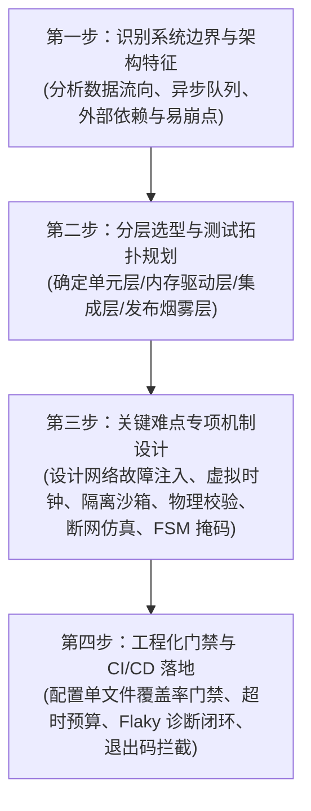

# 业界顶级开源项目自动化测试方案与测试用例设计知识库

> 专为构建工业级、高可靠、复杂软件系统自动化测试体系而设立的架构方案与实战用例设计知识库。深入解构 **51 个业界顶级开源项目**（涵盖系统级基础设施、AI 核心推理引擎、智能体工程、复杂 Web 交互大盘、协同画布、以及完全使用 AI 开发的现代 Web 系统）的自动化测试蓝图与质量工程。

---

## 目录导航

- [1. 51 个开源项目自动化测试方案全景矩阵](#1-51-个开源项目自动化测试方案全景矩阵)
  - [Part A: 系统级中间件、基础设施与基础架构 (01 ~ 11)](#part-a-系统级中间件基础设施与基础架构-01--11)
  - [Part B: 复杂 Web 交互与高性能数据处理平台 (12 ~ 21)](#part-b-复杂-web-交互与高性能数据处理平台-12--21)
  - [Part C: 完全/主要使用 AI 开发的开源 Web 系统 (22 ~ 31)](#part-c-完全主要使用-ai-开发的开源-web-系统-22--31)
  - [Part D: AI 开发工程、推理引擎与自动化评测方案 (32 ~ 51)](#part-d-ai-开发工程推理引擎与自动化评测方案-32--51)
- [2. 51 个项目代码量、文件数与测试规模综合统计报告](#2-51-个项目代码量文件数与测试规模综合统计报告)
- [3. 复杂系统与 AI 研发自动化测试核心范式](#3-复杂系统与-ai-研发自动化测试核心范式)
- [4. 51 大开源项目深度剖析文档索引](#4-51-大开源项目深度剖析文档索引)
- [5. 如何为复杂系统设计自动化测试方案](#5-如何为复杂系统设计自动化测试方案)
- [6. 可复用企业级设计模板](#6-可复用企业级设计模板)

---

## 1. 51 个开源项目自动化测试方案全景矩阵

### Part A: 系统级中间件、基础设施与基础架构 (01 ~ 11)

| 序号 | 开源项目 | 领域 / 架构类型 | 测试框架 / 基础设施 | 核心测试模式与特色技术 | 方案文档 |
| :---: | :--- | :--- | :--- | :--- | :---: |
| **01** | **DeepSeek Harness** | 自主 AI Agent / 微内核插件体系 | Vitest, Playwright, 自研 Mock Server | **100% 单文件覆盖率门禁**、24种可编排网络故障注入、会话快照与时空包络投影、验证真实物理世界而非自述日志 | [查看方案](schemes/01_deepseek-harness_ai_agent_testing_scheme.md) |
| **02** | **Microsoft Playwright** | 跨浏览器端到端 Web 自动化引擎 | Playwright Test Runner, CDP/Bidi | **自动等待（Auto-waiting）无休眠断言**、毫秒级 BrowserContext 状态沙箱隔离、网络底层路由拦截与 Trace 录制 | [查看方案](schemes/02_playwright_browser_e2e_testing_scheme.md) |
| **03** | **FastAPI** | 现代异步高性能 API 框架 | Pytest, Starlette TestClient, Pydantic | **纯内存 ASGI 请求驱动（零网络端口开销）**、无侵入依赖注入替换（Dependency Overrides）、OpenAPI 3.1 契约架构快照 | [查看方案](schemes/03_fastapi_restful_contract_testing_scheme.md) |
| **04** | **Moby (Docker)** | 云原生容器编排与系统守护进程 | Go `testing`, `gotest.tools/icmd`, DinD | **瞬时独立守护进程（Ephemeral Daemon）**、CLI 退出码与 stdout/stderr 精准分流断言、Linux Cgroups/内核属性穿透校验 | [查看方案](schemes/04_moby_docker_daemon_cli_testing_scheme.md) |
| **05** | **Redis** | 高性能分布式内存键值数据库 | Tcl 测试框架, AddressSanitizer, Valgrind | **动态多节点拓扑编排**、哨兵故障转移与脑裂模拟、增量同步积压缓冲区边界测试、C 语言内存安全常态化门禁 | [查看方案](schemes/05_redis_distributed_storage_testing_scheme.md) |
| **06** | **Microsoft VS Code** | 大型桌面富客户端 IDE 与插件生态 | Electron Driver, Playwright, Mocha | **打包制品真实原生 Smoke 烟雾测试**、独立 Extension Host 插件隔离宿主测试、内存虚拟文件系统（InMemoryFS） | [查看方案](schemes/06_vscode_desktop_extension_testing_scheme.md) |
| **07** | **Vitest** | 现代 ESM 测试运行器与编译工具 | Vitest 自身 (自举), Tinypool, Vite HMR | **Worker 线程池环境隔离与全局防污染断言**、内联快照 AST 源码安全回写、Watch 模式增量依赖反向追踪重跑 | [查看方案](schemes/07_vitest_test_runner_isolation_testing_scheme.md) |
| **08** | **Temporal** | 分布式工作流与高可靠状态机 | Temporal TestServer, Time-Skipping SDK | **虚拟时钟时间跃迁（Time-Skipping）**、历史生产事件确定性重放验证（Replay Test）、Activity 重试风暴与 Worker 强杀自愈 | [查看方案](schemes/08_temporal_distributed_workflow_testing_scheme.md) |
| **09** | **Apache APISIX** | 云原生高性能微服务 API 网关 | `Test::Nginx`, OpenResty, etcd 集群 | **声明式 HTTP 报文测试规范**、动态路由热加载零停机时延断言、插件生命周期 6 阶段管道拦截与双向熔断恢复 | [查看方案](schemes/09_apisix_cloud_native_gateway_testing_scheme.md) |
| **10** | **Sentry** | 高吞吐事件流监控与异步管道 | Pytest, In-memory TaskRunner, Snuba Mock | **异步流消息管道同步化受控测试**、错误指纹（Fingerprinting）与 Issue 智能聚合算法双向不变性断言、告警风暴抑制验证 | [查看方案](schemes/10_sentry_event_pipeline_monitoring_testing_scheme.md) |
| **11** | **LangChain** | 大模型应用与 RAG 智能体工具链 | Pytest, VCR.py, FakeListLLM | **基于 VCR 磁带的高保真网络录制与零成本离线回放**、非确定性自然语言输出容错反解析、Agent 死循环步数硬性熔断保护 | [查看方案](schemes/11_langchain_rag_agent_testing_scheme.md) |

---

### Part B: 复杂 Web 交互与高性能数据处理平台 (12 ~ 21)

| 序号 | 开源项目 | 领域 / 架构类型 | 测试框架 / 基础设施 | 核心测试模式与特色技术 | 方案文档 |
| :---: | :--- | :--- | :--- | :--- | :---: |
| **12** | **Discourse** | 现代大型社区论坛与协作平台 | RSpec, QUnit, Playwright, MessageBus | **富文本输入光标与异步上传占位符替换测试**、长轮询/WebSocket 订阅鉴权拦截、用户信任等级（TL）计算引擎幂等性断言 | [查看方案](schemes/12_discourse_community_web_testing_scheme.md) |
| **13** | **Grafana** | 交互式数据监控大盘与可视化引擎 | Playwright, React Testing Library, Go Test | **网格拖拽布局碰撞检测与坐标持久化校验**、模板变量级联下钻与查询动态插值、Go 统一告警滑动窗口状态机测试 | [查看方案](schemes/13_grafana_observability_dashboard_testing_scheme.md) |
| **14** | **Metabase** | 企业级交互式商业智能 (BI) 与数据平台 | Cypress, Clojure Test, 多数据库容器 | **无代码 Query Builder 动态 Join/聚合测试**、行级安全数据沙箱（Data Sandboxing）物理 SQL 校验、前端慢查询取消与连接回收 | [查看方案](schemes/14_metabase_bi_query_builder_testing_scheme.md) |
| **15** | **Cal.com** | 企业级日程调度与跨时区会议预约 | Playwright, Vitest, tRPC, Prisma | **跨时区与全球夏令时（DST）槽位算法测试**、高并发防双重预订（Double Booking）竞争测试、端到端预约链路流转断言 | [查看方案](schemes/15_calcom_scheduling_timezone_testing_scheme.md) |
| **16** | **Appwrite** | 开源后端即服务 (BaaS) 云控制台 | Swoole Client, Playwright, Docker Compose | **文档级细粒度权限信息隐匿测试 (404 Not Found)**、无服务器云函数沙箱超时硬熔断、Realtime WebSocket 广播毫秒级捕获 | [查看方案](schemes/16_appwrite_baas_console_testing_scheme.md) |
| **17** | **Supabase Studio** | 现代 Web 数据库管理与低代码工作台 | Playwright, PostgREST, pgTAP | **虚拟化网格表格单元格就地编辑（Inline Edit）断言**、可视化 RLS 策略生成与多角色隔离验证、Postgres 内核 pgTAP 契约测试 | [查看方案](schemes/17_supabase_studio_database_management_testing_scheme.md) |
| **18** | **NodeBB** | 高并发实时全双工社区平台 | Mocha, Socket.IO Client, Playwright | **Socket.IO 双工通知与未读红点计数器同步测试**、无限滚动（Infinite Scrolling）分页与 URL 动态同步、ACL 缓存原子失效测试 | [查看方案](schemes/18_nodebb_realtime_socket_forum_testing_scheme.md) |
| **19** | **Directus** | 实时数据平台与 Headless CMS | Vitest, Playwright, Knex.js | **看板（Kanban）跨列拖拽与状态翻转测试**、字段级权限（FLS）键不存在断言、跨 6 种主流 SQL 数据库容器 DDL 矩阵测试 | [查看方案](schemes/19_directus_headless_cms_data_platform_testing_scheme.md) |
| **20** | **Penpot** | 开源协同 UI/UX 设计与矢量画布平台 | Playwright, ClojureScript, WebAssembly | **无限画布绝对坐标拖拽绘制与几何运算断言**、多 BrowserContext 并发实时协同与光标跟随测试、自动布局（Auto-Layout）尺寸计算 | [查看方案](schemes/20_penpot_collaborative_design_canvas_testing_scheme.md) |
| **21** | **AFFiNE** | 本地优先 (Local-First) 知识库与白板 | Playwright, Rust OctoBase, Yjs / CRDT | **富文本文档与无界白板（Edgeless）双模态转换保真度测试**、Playwright 离线断网编辑（`setOffline(true)`）与 CRDT 冲突重连合并测试 | [查看方案](schemes/21_affine_local_first_crdt_canvas_testing_scheme.md) |

---

### Part C: 完全/主要使用 AI 开发的开源 Web 系统 (22 ~ 31)

| 序号 | 开源项目 | 领域 / 架构类型 | 测试框架 / 基础设施 | 核心测试模式与特色技术 | 方案文档 |
| :---: | :--- | :--- | :--- | :--- | :---: |
| **22** | **OpenHands** | 全自主 AI 软件工程师平台 | Pytest, Docker, Playwright, EventStream | **Docker 临时沙箱命令物理执行与退出码断言**、Agent 决策状态机步数硬熔断保护、EventStream 异步事件乱序解耦测试 | [查看方案](schemes/22_openhands_ai_engineer_platform_testing_scheme.md) |
| **23** | **Dify** | 开源 LLM 应用与可视化工作流平台 | Pytest, Playwright, Celery, React Flow | **DAG 工作流拓扑排序执行与条件分支状态断言**、知识库分块与代码块保护测试、工作流 YAML DSL 双向序列化回归 | [查看方案](schemes/23_dify_llm_workflow_orchestration_testing_scheme.md) |
| **24** | **FastGPT** | AI 知识库与复杂流程编排系统 | Vitest, MongoMemoryServer, Playwright | **混合检索（RRF）加权融合纯数学断言**、SSE 流中断 Token 余额原子扣减测试、MongoDB 复杂聚合管道验证 | [查看方案](schemes/24_fastgpt_knowledge_base_pipeline_testing_scheme.md) |
| **25** | **LobeChat** | 现代化 AI 个人工作台与插件平台 | Vitest, PGlite (Wasm), Playwright, Zustand | **多分支会话状态树（Branching Tree）分支切换断言**、浏览器内 Wasm PGlite 数据库测试、插件 OpenAPI Schema 校验 | [查看方案](schemes/25_lobechat_multimodal_agent_workbench_testing_scheme.md) |
| **26** | **LibreChat** | 全功能 AI 对话与代码解释器平台 | Jest, Docker Sandbox, Supertest | **Code Interpreter 沙箱代码执行与图表二进制回传测试**、容器越权系统调用防护阻断测试、对话树版本回溯断言 | [查看方案](schemes/26_librechat_code_interpreter_sandbox_testing_scheme.md) |
| **27** | **NextChat** | 轻量跨平台 AI 客户端与加密同步 | Vitest, Playwright, 虚拟 WebDAV | **WebDAV 跨端三向合并（3-Way Merge）冲突解决断言**、LaTeX / Mermaid 畸形渲染防白屏优雅降级测试、移动端视口适配 | [查看方案](schemes/27_nextchat_cross_platform_sync_testing_scheme.md) |
| **28** | **Khoj** | 个人 AI 知识助手与长程记忆引擎 | Pytest, ChromaDB (Memory), Playwright | **多源文件增量同步与已删除条目物理清退断言**、长程记忆唤醒得分（时间衰减 + 语义相似度）加权测试、零外网隔离测试 | [查看方案](schemes/28_khoj_personal_ai_memory_engine_testing_scheme.md) |
| **29** | **gpt-engineer** | AI 软件构建与代码自愈平台 | Pytest, Subprocess Watchdog, Playwright | **代码执行报错自愈闭环（Self-Healing Loop）测试**、非规范 Markdown 代码块多层级文件树提取测试、子进程超时看门狗 | [查看方案](schemes/29_gpt_engineer_self_healing_code_testing_scheme.md) |
| **30** | **Bolt.new** | 浏览器 WebContainer AI 全栈应用 | Vitest, Playwright, WebContainer API | **流式 XML 标签切片容错解析器（Action Parser）分块测试**、Playwright 真实浏览器端 WebContainer 启动与端口监听断言 | [查看方案](schemes/30_bolt_new_webcontainer_ai_studio_testing_scheme.md) |
| **31** | **AutoGPT** | 自主智能体平台与工作流执行器 | Pytest, Agent Protocol, Playwright | **人机协同高危操作审批拦截（Human-in-the-Loop Gateway）断言**、开源 Agent Protocol 标准契约测试、多 Agent 死锁守护 | [查看方案](schemes/31_autogpt_agent_workflow_builder_testing_scheme.md) |

---

### Part D: AI 开发工程、推理引擎与自动化评测方案 (32 ~ 51)

| 序号 | 开源项目 | 领域 / 架构类型 | 测试框架 / 基础设施 | 核心测试模式与特色技术 | 方案文档 |
| :---: | :--- | :--- | :--- | :--- | :---: |
| **32** | **vLLM** | 高性能 LLM 推理与服务引擎 | Pytest, CUDA Kernels, PyTorch | **PagedAttention 显存管理精度等价性测试**、连续批处理抢占换入换出断言、多 GPU 张量并行死锁看门狗 | [查看方案](schemes/32_vllm_llm_inference_engine_testing_scheme.md) |
| **33** | **Ollama** | 本地模型轻量运行时与管理网关 | Go Test, CGO, llama.cpp | **超微型 Toy GGUF 模型端到端真实推理测试**、显存 Keep-Alive 自动卸载状态机、Modelfile 分块 Hash 校验 | [查看方案](schemes/33_ollama_local_model_runtime_testing_scheme.md) |
| **34** | **LiteLLM** | 统一大模型 API 网关与负载中继 | Pytest, Router Fallbacks, Redis | **100+ 模型提供商协议双向映射参数清洗断言**、级联故障转移（Cascading Fallbacks）容灾自愈测试、Redis 缓存 | [查看方案](schemes/34_litellm_unified_gateway_fallback_testing_scheme.md) |
| **35** | **Promptfoo** | LLM 评测、Prompt 回归与红队测试 | Jest, Assertion Matchers, CLI | **多维断言匹配器（similar/regex/json）阈值测试**、自动化红队越狱注入攻击防御判定、CI 阻断退出码门禁 | [查看方案](schemes/35_promptfoo_llm_redteaming_eval_testing_scheme.md) |
| **36** | **Ragas** | 权威 RAG 检索生成自动化评估框架 | Pytest, Metric Math, Synthetic Data | **真实性抗幻觉（Faithfulness）原子声明推理断言**、上下文精确度排序衰减数学测试、合成数据集多样性验证 | [查看方案](schemes/36_ragas_rag_evaluation_matrix_testing_scheme.md) |
| **37** | **Arize Phoenix** | AI 可观测性、OTel 追踪与 Eval 平台 | Pytest, OpenTelemetry, UMAP | **OpenTelemetry 异步 Span 链路因果拓扑与异常标记测试**、高维 Embedding 漂移数学计算测试、无头降维验证 | [查看方案](schemes/37_phoenix_ai_observability_tracing_testing_scheme.md) |
| **38** | **Instructor** | Pydantic 驱动的大模型结构化输出 | Pytest, Client Patches, Streaming | **Pydantic 校验失败自动反思重试（Reask Loop）测试**、流式增量局部 JSON 解析断言、v1/v2 双版本兼容矩阵 | [查看方案](schemes/38_instructor_structured_output_validation_testing_scheme.md) |
| **39** | **Outlines** | FSM 有限状态机受限生成解码引擎 | Pytest, Regex-to-FSM, Lark CFG | **正则表达式编译 DFA 状态转移与接受态断言**、LogitsProcessor 掩码重采样数学精度测试、纯分词器离线单测 | [查看方案](schemes/39_outlines_guided_generation_grammar_testing_scheme.md) |
| **40** | **Guidance** | 高性能交替执行受控模板引擎 | Pytest, C++ Grammar, Step Counter | **交替执行固定文本前缀跳跃与计步断言**、select() 公共前缀折叠优化测试、模板变量捕获字典正确性校验 | [查看方案](schemes/40_guidance_constrained_generation_testing_scheme.md) |
| **41** | **Aider** | 终端 AI 结对编程与代码自动补丁 | Pytest, Git Sandbox, Tree-sitter | **搜索替换差异块（Search/Replace Diff）模糊对齐测试**、原子化 Git 自动提交与 /undo 回滚物理验证、代码地图 | [查看方案](schemes/41_aider_ai_pair_programming_git_patch_testing_scheme.md) |
| **42** | **SWE-bench** | 软件工程智能体真实基准评测平台 | Pytest, Docker Sandbox, Grader | **正反双轨判决（FAIL_TO_PASS & PASS_TO_PASS）逻辑断言**、防作弊补丁审计与测试文件篡改检测、日志正则解析 | [查看方案](schemes/42_swe_bench_agent_evaluation_benchmark_testing_scheme.md) |
| **43** | **DSPy** | 声明式 LM 编程与提示词编译器 | Pytest, Teleprompter, DummyLM | **声明式 Signature 编译与多字段提取断言**、BootstrapFewShot 优化器在样本集上的单调增益测试、模块持久化 | [查看方案](schemes/43_dspy_compiled_lm_pipeline_testing_scheme.md) |
| **44** | **CrewAI** | 多智能体角色扮演协作框架 | Pytest, Delegation Guard, Process | **智能体相互委派死锁防护（Deadlock Guard）测试**、层次化团队任务按序下发与上下文传递、Tool 失败重试自愈 | [查看方案](schemes/44_crewai_multi_agent_collaboration_testing_scheme.md) |
| **45** | **AutoGen** | 微软多 Agent 对话与代码沙箱框架 | Pytest, UserProxy Sandbox, Cache | **UserProxyAgent 自动提取代码在沙箱执行与结果回传断言**、GroupChat 会话终止条件与发言人轮转调度测试 | [查看方案](schemes/45_autogen_conversable_agent_sandbox_testing_scheme.md) |
| **46** | **LlamaIndex** | 企业级数据框架与上下文增强 RAG | Pytest, RecursiveRetriever, MockEmbed | **父子节点递归检索器（Recursive Retriever）拓扑回溯断言**、元数据硬性过滤测试、确定性正交向量桩 | [查看方案](schemes/46_llamaindex_data_framework_hierarchical_rag_testing_scheme.md) |
| **47** | **Semantic Kernel** | 微软企业大模型 SDK 与插件微内核 | Pytest, dotnet test, Filters | **函数调用过滤拦截器（Invocation Filter）短路与审计测试**、原生与语义插件反射元数据 Schema 校验 | [查看方案](schemes/47_semantic_kernel_plugin_orchestration_testing_scheme.md) |
| **48** | **Chainlit** | 对话式 AI 与 Agent 生产级 Web 界面 | Playwright, Socket.IO, AskAction | **人机交互操作卡片（AskActionMessage）挂起与唤醒测试**、嵌套思维链步骤树（Step Hierarchy）协议因果断言 | [查看方案](schemes/48_chainlit_conversational_ai_ui_testing_scheme.md) |
| **49** | **OpenWebUI** | 全功能大模型 Web 交互与聚合门户 | Playwright, FastAPI RBAC, SQLite | **RBAC 多角色越权阻断测试（Security Gating）**、知识库引用角标（Citations）高亮与源文档弹窗锚点跳转断言 | [查看方案](schemes/49_openwebui_fullstack_ai_interface_testing_scheme.md) |
| **50** | **Mem0** | 跨会话大模型长程记忆与图谱层 | Pytest, Kuzu Graph, Vector Store | **记忆事实冲突自愈更新（Conflict Resolution）断言**、多级租户作用域（Tenancy Scope）绝对物理隔离测试 | [查看方案](schemes/50_mem0_long_term_memory_graph_testing_scheme.md) |
| **51** | **Guardrails AI** | 大模型输入输出安全合规护栏 | Pytest, On-Fail Policies, PII | **On-Fail 策略矩阵（Fix vs ReAsk vs Filter）行为断言**、PII 隐私信息自动识别掩码脱敏测试、递归深度熔断 | [查看方案](schemes/51_guardrails_ai_output_safety_compliance_testing_scheme.md) |

---

## 2. 51 个项目代码量、文件数与测试规模综合统计报告

知识库全面收录并计算了这 51 个开源项目的总代码量、文件总数、自动化测试用例数与测试代码量统计指标：

👉 **[点击查阅完整统计报告：51 个顶级开源项目代码量、文件数与自动化测试规模综合统计报告](metrics/open_source_projects_code_and_test_metrics.md)**

* **全库总代码量**：51 个项目累计分析代码量逾 **1,800 万行**，覆盖文件数达 **11 万+**，自动化测试用例总量超过 **23 万+**；
* **测试代码占比分布**：AI 领域与工业级框架测试代码占比普遍在 **30% ~ 48%**，深度依托确定性状态机与无模型桩实现毫秒级回归。

---

## 3. 复杂系统与 AI 研发自动化测试核心范式

解构这 51 个顶级开源项目后，可提炼出以下适用于现代复杂系统与 AI 研发的九大测试核心范式：

```
┌────────────────────────────────────────────────────────────────────────┐
│                      现代复杂系统与 AI 测试设计九大核心范式             │
├────────────────────────────────────────────────────────────────────────┤
│ 1. 验证真实世界，拒绝自述日志 (Verify the world, not the self-report)   │
│    - 任何写操作，必须穿透到底层物理文件哈希、数据库落盘行、系统进程表。│
├────────────────────────────────────────────────────────────────────────┤
│ 2. 仅在边界打桩，内部管线全量真实装配 (Mock boundaries, not internals)│
│    - 仅在网络抖动、商业 LLM API 等非确定性边界 Mock，内部所有状态机真实运行。 │
├────────────────────────────────────────────────────────────────────────┤
│ 3. 引入虚拟时钟与确定性回放 (Virtual Clocks & Deterministic Replay)    │
│    - 摆脱物理 sleep 等待，毫秒级推进长周期定时器；消除时间戳比对快照。 │
├────────────────────────────────────────────────────────────────────────┤
│ 4. 严苛的环境与进程资源隔离 (Strict Resource Sandbox & Lifecycle)      │
│    - 每个用例专享临时目录与动态端口，无论测试成功失败必须在 teardown 彻底回收。│
├────────────────────────────────────────────────────────────────────────┤
│ 5. 双上下文并发驱动协同验证 (Multi-Context Concurrency & Presence)    │
│    - 针对多人协同、日历抢占，在一个用例内并发启动 2 个 BrowserContext 检验同步。│
├────────────────────────────────────────────────────────────────────────┤
│ 6. 真实断网仿真验证容灾与本地优先 (Network Offline Simulation)          │
│    - 利用 setOffline(true) 验证弱网与断网编辑，恢复后检验 CRDT/增量同步收敛。 │
├────────────────────────────────────────────────────────────────────────┤
│ 7. 流式响应断裂与恶意分块灌入测试 (Malicious Chunk Feeding & Stream Cuts)│
│    - 在协议标签中间、中文字符截断处故意切断流，断言解析器状态机优雅恢复与重试。│
├────────────────────────────────────────────────────────────────────────┤
│ 8. 正反双轨回归与防作弊护栏 (Fail-to-Pass & Pass-to-Pass & Anti-Cheat) │
│    - 修复测试用例变绿的同时，现有测试必须 100% 保持绿色，且锁定测试集防篡改。│
├────────────────────────────────────────────────────────────────────────┤
│ 9. 基于状态机与受限生成的确定性测试 (FSM Grammar & Guided Decoding)   │
│    - 将非确定性自然语言收敛为数学证明的状态转移，以 Logits 掩码断言输出合规。 │
└────────────────────────────────────────────────────────────────────────┘
```

---

## 4. 51 大开源项目深度剖析文档索引

### 系统与中后台架构 (01 ~ 11)
1. [DeepSeek Harness：Everything is a Plugin 架构下的 Agent 执行循环与 100% 门禁测试方案](schemes/01_deepseek-harness_ai_agent_testing_scheme.md)
2. [Microsoft Playwright：跨浏览器自动化驱动、CDP 协议与智能等待测试方案](schemes/02_playwright_browser_e2e_testing_scheme.md)
3. [FastAPI：基于 Starlette TestClient 的内存请求驱动与 OpenAPI 契约测试方案](schemes/03_fastapi_restful_contract_testing_scheme.md)
4. [Moby (Docker)：守护进程生命周期、CLI 断言与 Linux 内核隔离集成测试方案](schemes/04_moby_docker_daemon_cli_testing_scheme.md)
5. [Redis：基于 Tcl 的分布式拓扑编排、主从增量同步与内存安全测试方案](schemes/05_redis_distributed_storage_testing_scheme.md)
6. [Microsoft VS Code：多进程桌面架构、Electron 烟雾测试与虚拟文件系统测试方案](schemes/06_vscode_desktop_extension_testing_scheme.md)
7. [Vitest：测试运行器自身自举、Worker 并发隔离与 AST 快照回写测试方案](schemes/07_vitest_test_runner_isolation_testing_scheme.md)
8. [Temporal：分布式工作流状态机、虚拟时钟跳跃与历史事件重放测试方案](schemes/08_temporal_distributed_workflow_testing_scheme.md)
9. [Apache APISIX：声明式报文驱动、动态路由零停机热加载与网关管道测试方案](schemes/09_apisix_cloud_native_gateway_testing_scheme.md)
10. [Sentry：异步消息管道同步化驱动、事件指纹聚合与告警规则测试方案](schemes/10_sentry_event_pipeline_monitoring_testing_scheme.md)
11. [LangChain：网络磁带录制回放、结构化解析容错与 Agent 熔断测试方案](schemes/11_langchain_rag_agent_testing_scheme.md)

### 复杂 Web 交互与数据平台 (12 ~ 21)
12. [Discourse：富文本编辑器光标占位符、MessageBus 实时推送与信任等级计算测试方案](schemes/12_discourse_community_web_testing_scheme.md)
13. [Grafana：网格拖拽布局碰撞、模板变量级联下钻与告警滑动窗口测试方案](schemes/13_grafana_observability_dashboard_testing_scheme.md)
14. [Metabase：可视化 Query Builder 多表关联、行级数据沙箱与慢查询取消测试方案](schemes/14_metabase_bi_query_builder_testing_scheme.md)
15. [Cal.com：跨时区夏令时槽位计算、高并发双重预订拦截与预约全链路测试方案](schemes/15_calcom_scheduling_timezone_testing_scheme.md)
16. [Appwrite：文档级细粒度权限隐匿、云函数沙箱超时硬熔断与 WebSocket 广播测试方案](schemes/16_appwrite_baas_console_testing_scheme.md)
17. [Supabase Studio：虚拟滚动表格就地编辑、可视化 RLS 策略与 pgTAP 数据库测试方案](schemes/17_supabase_studio_database_management_testing_scheme.md)
18. [NodeBB：Socket.IO 双工即时通知、无限滚动分页流与 ACL 缓存失效测试方案](schemes/18_nodebb_realtime_socket_forum_testing_scheme.md)
19. [Directus：看板视图拖拽跨列、字段级权限数据掩码与 6 种数据库 DDL 矩阵测试方案](schemes/19_directus_headless_cms_data_platform_testing_scheme.md)
20. [Penpot：矢量无限画布绝对坐标拖拽、多浏览器实时协同光标与自动布局测试方案](schemes/20_penpot_collaborative_design_canvas_testing_scheme.md)
21. [AFFiNE：文档白板双模态切换保真度、离线断网编辑与 CRDT 冲突合并测试方案](schemes/21_affine_local_first_crdt_canvas_testing_scheme.md)

### 完全/主要使用 AI 开发的开源 Web 系统 (22 ~ 31)
22. [OpenHands：Docker 隔离沙箱命令执行、Agent 步数熔断与 EventStream 异步事件测试方案](schemes/22_openhands_ai_engineer_platform_testing_scheme.md)
23. [Dify：DAG 工作流拓扑调度、知识库代码块保护切片与 YAML DSL 架构测试方案](schemes/23_dify_llm_workflow_orchestration_testing_scheme.md)
24. [FastGPT：混合检索 RRF 打分融合、SSE 流中断 Token 原子扣减与 Mongo 聚合测试方案](schemes/24_fastgpt_knowledge_base_pipeline_testing_scheme.md)
25. [LobeChat：多分支会话状态树、Wasm PGlite 数据库迁移与插件 Schema 拦截测试方案](schemes/25_lobechat_multimodal_agent_workbench_testing_scheme.md)
26. [LibreChat：Code Interpreter 沙箱代码执行与图表产物、容器越权拦截测试方案](schemes/26_librechat_code_interpreter_sandbox_testing_scheme.md)
27. [NextChat：WebDAV 三向合并冲突解决、LaTeX / Mermaid 优雅降级防白屏测试方案](schemes/27_nextchat_cross_platform_sync_testing_scheme.md)
28. [Khoj：多源文件增量同步与删除清理、长程记忆衰减得分加权计算测试方案](schemes/28_khoj_personal_ai_memory_engine_testing_scheme.md)
29. [gpt-engineer：代码执行自愈闭环（Self-Healing）、脏 Markdown 多文件解析测试方案](schemes/29_gpt_engineer_self_healing_code_testing_scheme.md)
30. [Bolt.new：流式 XML 标签切片容错解析器、真实 WebContainer 浏览器端启动测试方案](schemes/30_bolt_new_webcontainer_ai_studio_testing_scheme.md)
31. [AutoGPT：人机协同高危操作审批拦截（Human-in-the-Loop）、Agent Protocol 标准测试方案](schemes/31_autogpt_agent_workflow_builder_testing_scheme.md)

### AI 开发工程、推理引擎与自动化评测方案 (32 ~ 51)
32. [vLLM：PagedAttention 显存管理精度等价性、连续批处理抢占与张量并行测试方案](schemes/32_vllm_llm_inference_engine_testing_scheme.md)
33. [Ollama：超微型 Toy GGUF 模型端到端推理、显存 Keep-Alive 自动卸载状态机测试方案](schemes/33_ollama_local_model_runtime_testing_scheme.md)
34. [LiteLLM：100+ 模型提供商协议双向映射参数清洗、级联故障转移容灾自愈测试方案](schemes/34_litellm_unified_gateway_fallback_testing_scheme.md)
35. [Promptfoo：多维断言匹配器（similar/regex/json）阈值评估与自动化红队越狱测试方案](schemes/35_promptfoo_llm_redteaming_eval_testing_scheme.md)
36. [Ragas：真实性抗幻觉（Faithfulness）原子声明推理断言与检索精确度数学测试方案](schemes/36_ragas_rag_evaluation_matrix_testing_scheme.md)
37. [Arize Phoenix：OpenTelemetry Span 链路因果拓扑与高维 Embedding 漂移测试方案](schemes/37_phoenix_ai_observability_tracing_testing_scheme.md)
38. [Instructor：Pydantic 校验失败自动反思重试（Reask Loop）与增量流式解析测试方案](schemes/38_instructor_structured_output_validation_testing_scheme.md)
39. [Outlines：正则表达式编译有限状态机（DFA/FSM）与 Logits 掩码重采样数学测试方案](schemes/39_outlines_guided_generation_grammar_testing_scheme.md)
40. [Guidance：交替执行固定文本前缀跳跃、select() 公共前缀折叠优化测试方案](schemes/40_guidance_constrained_generation_testing_scheme.md)
41. [Aider：搜索替换差异块（Search/Replace Diff）模糊对齐与原子 Git 提交回滚测试方案](schemes/41_aider_ai_pair_programming_git_patch_testing_scheme.md)
42. [SWE-bench：正反双轨判决（FAIL_TO_PASS & PASS_TO_PASS）与防作弊补丁审计测试方案](schemes/42_swe_bench_agent_evaluation_benchmark_testing_scheme.md)
43. [DSPy：声明式 Signature 编译与 BootstrapFewShot 优化器在样本集上的单调增益测试方案](schemes/43_dspy_compiled_lm_pipeline_testing_scheme.md)
44. [CrewAI：智能体相互委派死锁防护（Deadlock Guard）与层次化团队任务调度测试方案](schemes/44_crewai_multi_agent_collaboration_testing_scheme.md)
45. [AutoGen：UserProxyAgent 自动提取代码沙箱执行与 GroupChat 会话终止条件测试方案](schemes/45_autogen_conversable_agent_sandbox_testing_scheme.md)
46. [LlamaIndex：父子节点递归检索器（Recursive Retriever）拓扑回溯与元数据过滤测试方案](schemes/46_llamaindex_data_framework_hierarchical_rag_testing_scheme.md)
47. [Semantic Kernel：函数调用过滤拦截器（Invocation Filter）短路与插件反射元数据测试方案](schemes/47_semantic_kernel_plugin_orchestration_testing_scheme.md)
48. [Chainlit：人机交互操作卡片（AskActionMessage）挂起唤醒与嵌套思维链步骤树测试方案](schemes/48_chainlit_conversational_ai_ui_testing_scheme.md)
49. [OpenWebUI：RBAC 多角色越权阻断（Security Gating）与知识库引用角标高亮跳转测试方案](schemes/49_openwebui_fullstack_ai_interface_testing_scheme.md)
50. [Mem0：记忆事实冲突自愈更新（Conflict Resolution）与多租户作用域隔离测试方案](schemes/50_mem0_long_term_memory_graph_testing_scheme.md)
51. [Guardrails AI：On-Fail 策略矩阵（Fix vs ReAsk vs Filter）与 PII 隐私脱敏合规测试方案](schemes/51_guardrails_ai_output_safety_compliance_testing_scheme.md)

---

## 5. 如何为复杂系统设计自动化测试方案

当面临一个新的复杂业务系统（如高并发电商交易系统、AI 多智能体协同平台、分布式调度引擎、协同画布或低代码工作台）时，建议按以下四步法进行方案设计：



---

## 6. 可复用企业级设计模板

为了方便后续在团队内部或新项目中快速产出高质量的自动化测试方案，知识库提供了标准化的设计模板：

👉 **[点击查阅：企业级复杂系统自动化测试方案设计规范与标准模板](templates/enterprise_automated_test_plan_template.md)**

该模板包含：
* 系统背景与技术拓扑全景定义
* 分层测试职责与覆盖率预算矩阵
* 核心业务功能用例三要素设计规范（输入/驱动/物理断言）
* 故障注入与混沌容灾设计
* CI/CD 流水线门禁指标与并发性能预算配置
